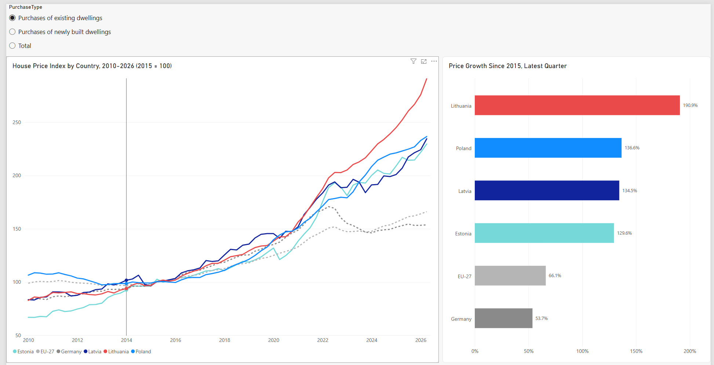
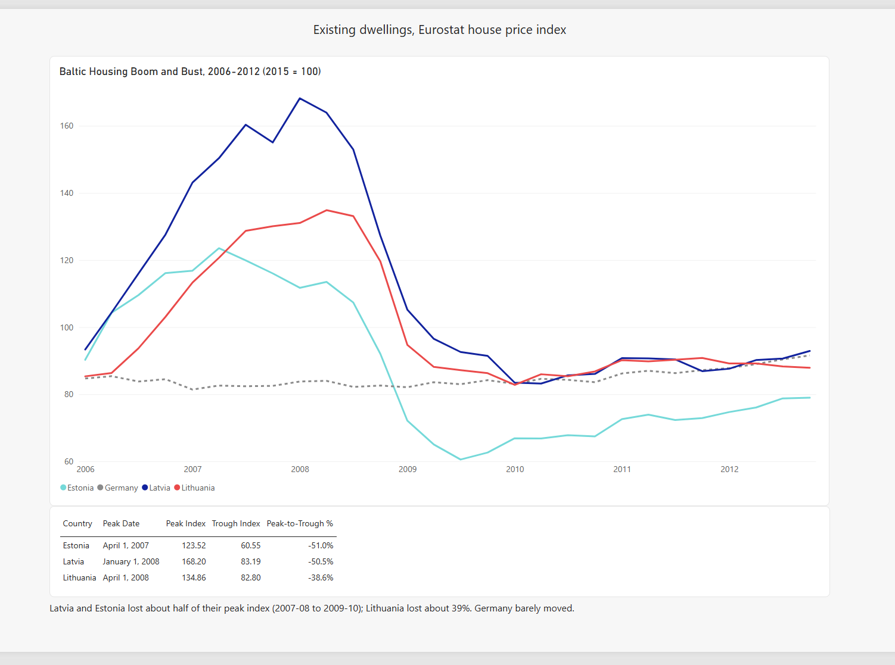

# European House Prices: Baltics vs Germany and EU

A two-page Power BI dashboard built from Eurostat's quarterly House Price Index. It asks two questions:

1. Which of the Baltic countries (plus Poland) saw the fastest price growth since 2015, compared with Germany and the EU?
2. How large was the Baltic housing boom and bust of 2006-2012, and how did the three countries differ?

## Dashboard preview

| Overview | Boom and bust |
|---|---|
|  |  |

A PDF export of both pages is in [`/pdf`](pdf/).

## Key findings

All figures are for **existing dwellings**, index 2015 = 100, latest quarter 2026-Q2.

**Growth since 2015**

| Country | Growth since 2015 |
|---|---|
| Lithuania | +190.9% |
| Poland | +136.6% |
| Latvia | +134.5% |
| Estonia | +129.6% |
| EU-27 | +66.1% |
| Germany | +53.7% |

- Lithuania's index is almost 3x its 2015 level, the highest of the six series.
- Germany's index has been broadly flat since 2022 and is the lowest of the six.

**Baltic boom and bust (2006-2012)**

| Country | Peak (quarter start) | Peak index | Trough index | Peak-to-trough |
|---|---|---|---|---|
| Estonia | Apr 2007 | 123.5 | 60.6 | -51.0% |
| Latvia | Jan 2008 | 168.2 | 83.2 | -50.5% |
| Lithuania | Apr 2008 | 134.9 | 82.8 | -38.6% |

- Latvia had the highest peak, but Estonia fell by about the same proportion.
- Lithuania had the smallest fall of the three.
- Germany barely moved over the same period.

## Data

- **Source:** Eurostat, *House price index (2015 = 100) - quarterly data* (`prc_hpi_q`), downloaded as SDMX-CSV 1.0. File last updated by Eurostat on 01/10/2026.
- **Coverage:** 2005-Q1 to 2026-Q2, 38 geographic entities in the raw file, three purchase types (existing, newly built, total) and four units.
- **Raw file:** `data/raw/eurostat_house_price_index_quarterly_raw.csv`, 33,617 rows, kept unchanged.

## Method

Cleaning was done in Power Query. The raw query is untouched, and a second query (`house_price_clean`) references it.

1. Removed unused columns (`DATAFLOW`, `LAST UPDATE`, `freq`, `CONF_STATUS`, then `unit`).
2. Filtered `unit` to **Quarterly index, 2015=100**. Growth rates are calculated in DAX instead of using Eurostat's rate columns.
3. Kept six series: Lithuania, Latvia, Estonia, Germany, Poland and EU-27 (renamed from "European Union - 27 countries (from 2020)"). Other EU and euro-area aggregates were dropped.
4. Removed 30 rows with missing values (1,456 to **1,426 rows**).
5. Renamed columns and converted `TIME_PERIOD` (e.g. `2008-Q1`) into a real `QuarterStart` date.
6. Set data types.

**Data model:** a `Date` table (2005-2026, with Year, Quarter and YearQuarter columns) in a one-to-many relationship with `house_price_clean[QuarterStart]`.

**Main DAX measures**

- `Index`: average of `IndexValue` in the current filter context.
- `Latest Index` and `Growth Since 2015 %`: latest-quarter index and its growth against the 2015 base of 100.
- `Latest YoY %`: latest quarter against the same quarter a year earlier.
- `Peak Index`, `Peak Date`, `Trough Index`, `Peak-to-Trough %`: peak within 2006-2010, trough between the peak and the end of 2012.

## Limitations

- This is a **price index**, not euro prices per square metre. It shows change relative to 2015, not whether homes are expensive. It is not adjusted for inflation.
- The series start at different dates. Latvia and Lithuania have no values before 2006-Q1, and Poland's and EU-27's existing-dwelling series only begin around 2009-Q4 to 2010-Q1, so the comparison chart starts in 2010 and the boom-and-bust page starts in 2006.
- Some recent values are flagged by Eurostat as provisional (`p`), and the raw data also contains estimated (`e`), break-in-series (`b`) and definition-difference (`d`) flags. The flag column is kept in the data but the dashboard does not yet mark these points. Year-on-year changes across a break flag may not reflect the market alone.
- The peak and trough are measured on quarterly data within fixed windows (peak 2006-2010, trough up to 2012), so they depend on those choices. "Peak date" is the first day of the quarter.
- The numbers describe what happened, not why. The project makes no claims about causes.

## Repository structure

```
data/raw/        original Eurostat CSV (unchanged)
pbix/            Power BI report
pdf/             PDF export of both pages
screenshots/     images used in this README
```

## Tools

Power BI Desktop, Power Query (M) and DAX.
